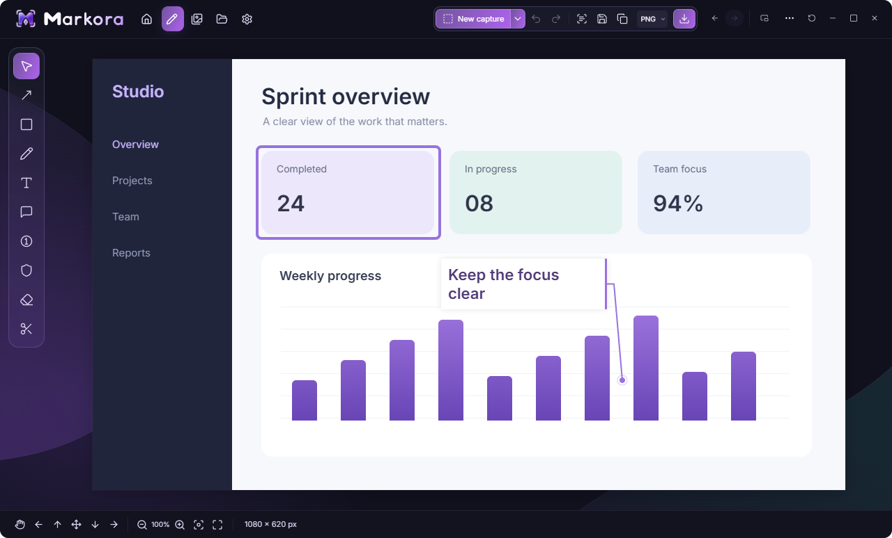
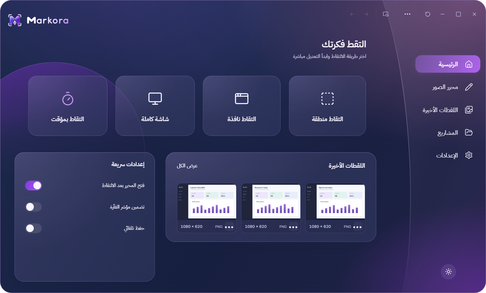
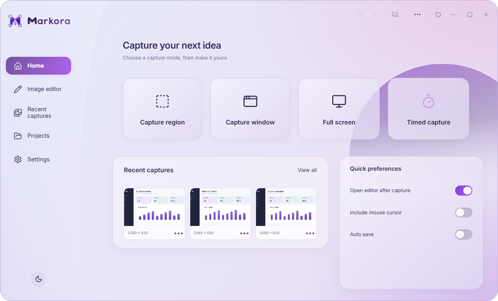
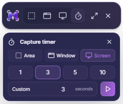

  <strong>عرض بالعربية</strong> &nbsp;|&nbsp; <a href="README.md" dir="ltr">Display in English</a>

<h1 dir="rtl">Markora 1.1</h1>

**التقط. علّق. واجعل كل فكرة أوضح.**

برنامج لالتقاط الشاشة والتعليق على الصور في نظام Windows، بواجهتين عربية وإنكليزية، وشريط التقاط مصغّر (Mini)، ومظهرين زجاجيين فاتح وداكن.

[تنزيل الإصدار 1.1](https://github.com/MhDTam/Markora-Releases/releases/tag/v1.1.0) · [أحدث إصدار](https://github.com/MhDTam/Markora-Releases/releases/latest) · [ملاحظات الإصدار](RELEASE-NOTES-1.1.md) · [الإبلاغ عن مشكلة](https://github.com/MhDTam/Markora-Releases/issues)

## التنزيل والتشغيل

| الحزمة | الاستخدام |
| --- | --- |
| [النسخة المحمولة (Portable ZIP)](https://github.com/MhDTam/Markora-Releases/releases/download/v1.1.0/Markora-1.1.0-portable.zip) | فكّ ضغط الملف كاملًا، ثم شغّل <code dir="ltr">Markora.exe</code>. لا تتطلب تثبيتًا. |
| [مثبّت Windows](https://github.com/MhDTam/Markora-Releases/releases/download/v1.1.0/Markora_1.1.0_x64-setup.exe) | يثبّت برنامج Markora لنظام Windows x64 (بواجهتي تثبيت عربية وإنكليزية). |
| [بصمات التحقق SHA-256](https://github.com/MhDTam/Markora-Releases/releases/download/v1.1.0/SHA256SUMS.txt) | للتحقق من سلامة الحزم المُنزّلة ومطابقتها. |

يتطلب البرنامج نظام Windows 10/11 x64 وبيئة تشغيل Microsoft Edge WebView2 Runtime. يستطيع المثبّت تنزيل WebView2 عند الحاجة، لذلك قد يتطلب التثبيت لأول مرة اتصالًا بالإنترنت. حزم الإصدار 1.1 غير موقّعة رقميًا.

يبدأ Markora في **الوضع المصغّر (Mini)** للالتقاط السريع. يمكنك توسيعه لفتح لوحة التحكم الكاملة، أو بدء الالتقاط مباشرة ليفتح المحرر فورًا. عند استخدام مشغّل الإطلاق المرافق، أبقِ ملف <code dir="ltr">Markora Mini.exe</code> بجانب <code dir="ltr">Markora.exe</code>. النسخة المحمولة تعمل دون تثبيت، مع بقاء التفضيلات وآخر ثلاث لقطات محفوظة محليًا ضمن ملف مستخدم Windows.

## الالتقاط والتحرير

- **أوضاع الالتقاط والمؤقت:** التقاط منطقة محددة، أو نافذة مفتوحة (مع معاينة حية للنوافذ)، أو الشاشة كاملة؛ مع مؤقت زمني يتضمن محددًا مستقلًا لنوع الالتقاط وإمكانية تحديد مدة مخصصة بالثواني (من 1 إلى 60 ثانية).
- **الدقة والتصدير والنسخ:** التقاط غير مضغوط بالدقة الأصلية للشاشة بصيغة PNG. يمكنك التصدير بصيغ PNG أو JPEG أو WebP، واختيار الجودة وحجم الإخراج، أو نسخ الصورة مباشرة إلى الحافظة دون حفظها.
- **أدوات الرسم والتعليق:** أسهم وخطوط مستقيمة ومنحنية، أشكال هندسية (مستطيل، دائرة، مثلث، معيّن)، قلم حر، أداة تمييز (Highlighter)، نصوص قابلة للتعديل، تعليقات توضيحية (Callouts) بأنماط متعددة، خطوات مرقّمة، حجب معتم، قص الصورة، وممحاة التعليقات.
- **التحديد والتحكم باللوحة:** تحديد بالسحب، تحريك العنصر كاملًا، تراجع وإعادة، وتكبير وتحريك اللوحة. استمر بالضغط على <kbd dir="ltr">Shift</kbd> لرسم أشكال متساوية الأضلاع، أو تقييد زوايا الخطوط، أو تغيير الحجم مع الحفاظ على التناسب.
- **المشاريع والسجل والحفظ:** حفظ وفتح مشاريع <code dir="ltr">.markora</code> القابلة للتعديل، والاحتفاظ بآخر ثلاث لقطات، مع خيار الحفظ التلقائي ومجلد حفظ قابل للتخصيص، بالإضافة إلى خيار الإغلاق إلى شريط النظام (System Tray).
- **اللغة والمظهر:** واجهتان عربية (RTL) وإنكليزية (LTR)، ومظهران فاتح وداكن، ودعم تقليل الحركة.
- **استخراج النص عبر Gemini OCR (اختياري):** استخراج النصوص العربية والإنكليزية من الصور باستخدام مفتاح API الخاص بك والمحفوظ بأمان في مدير بيانات اعتماد Windows، مع زر لفحص الاتصال بالنموذج.
- **إشعارات التحديثات:** التحقق من توفر إصدارات جديدة تلقائيًا عند فتح البرنامج ومن صفحة الإعدادات (مع إمكانية التحكم بالخيار)، وإظهار إشعار مباشر مع رابط التحميل من GitHub.

| الاختصار الافتراضي | الوظيفة |
| --- | --- |
| <kbd dir="ltr">Ctrl+Shift+1</kbd> | التقاط منطقة |
| <kbd dir="ltr">Ctrl+Shift+2</kbd> | التقاط نافذة |
| <kbd dir="ltr">Ctrl+Shift+3</kbd> | التقاط الشاشة كاملة |
| <kbd dir="ltr">Ctrl+Shift+4</kbd> | تكرار الالتقاط بالمؤقت |
| <kbd dir="ltr">1–9, 0</kbd> | مجموعات أدوات المحرر (أثناء عدم الكتابة) |
| الضغط المطوّل بزر الفأرة الأيمن | تحريك الصورة داخل المحرر |
| <kbd dir="ltr">Ctrl+Enter</kbd> / <kbd dir="ltr">Escape</kbd> | تأكيد / إلغاء تعديل النص |

انقر على أيقونة الساعة لاختيار مدة المؤقت ونوع الالتقاط، أو انقر عليها مرتين لتكرار آخر مؤقت. أزرار الالتقاط المباشر لا ترث تأخير المؤقت. تمسح الممحاة التعليقات فقط وتُبقي لقطة الشاشة الأصلية سليمة. كما يمكنك تخصيص اختصارات الالتقاط من الإعدادات.

## لقطات من التطبيق

نوافذ حقيقية من الإصدار الأول Markora V1 باستخدام مستندات تجريبية مُولّدة؛ ولا تتضمن أي لقطات شخصية.

**العربية · المظهر الداكن**

**الإنكليزية · المظهر الفاتح**

**الوضع المصغّر (Mini) والمؤقت المدمج**

## الخصوصية والترخيص

يتم الالتقاط والتحرير محليًا على جهازك. يرسل خيار استخراج النص عبر Gemini OCR الصورة المعدّلة الحالية إلى Google فقط عندما تطلب الاستخراج صراحةً، وقد تنطبق رسوم استخدام وفق حسابك. كما يقتصر فحص التحديثات الاختياري على الاستعلام عن رقم أحدث إصدار من GitHub فقط دون إرسال أي بيانات شخصية. راجع [ملف الخصوصية](PRIVACY.md).

**برنامج Markora مملوك (Proprietary) وليس مفتوح المصدر.** يحتوي هذا المستودع على التوثيق ولقطات الشاشة والإصدارات التنفيذية فقط، ولا يُنشر الكود المصدري للتطبيق هنا. راجع [الترخيص](LICENSE.txt) و[إشعارات الطرف الثالث](THIRD-PARTY-NOTICES.txt) و[ملاحظات الإصدار](RELEASE-NOTES-1.1.md) و[تقرير التحقق QA](QA.md).

عند الإبلاغ عن مشكلة، يُرجى تضمين رقم إصدار Markora، وإصدار Windows، ونسبة تكبير الشاشة (Display scaling)، وخطوات إعادة المشكلة. لا تنشر مفاتيح API أو لقطات شاشة خاصة.

