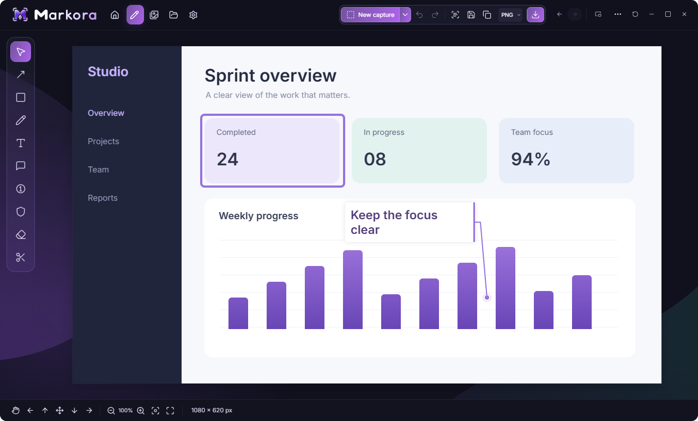
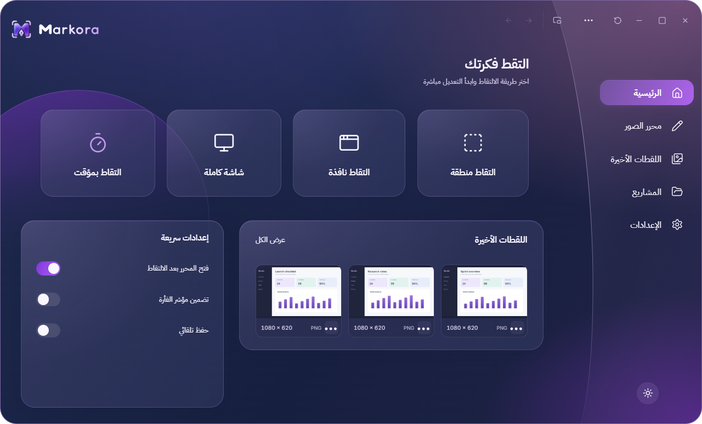
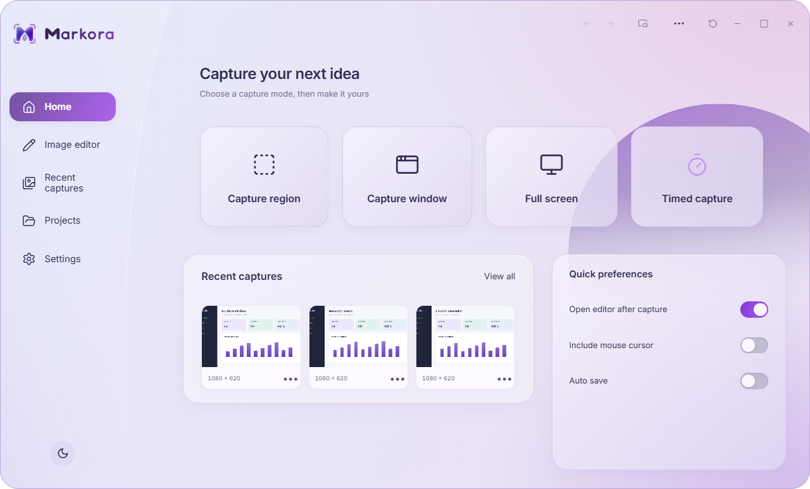
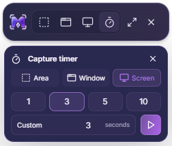

  <strong>Display in English</strong> &nbsp;|&nbsp; <a href="README.ar.md" dir="rtl">عرض بالعربية</a>

# Markora 1.1

**Capture. Annotate. Make it clear.**

A Windows screenshot and annotation app with Arabic and English interfaces, a compact Mini capture bar, and light and dark glass themes.

[Download 1.1](https://github.com/MhDTam/Markora-Releases/releases/tag/v1.1.0) · [Latest release](https://github.com/MhDTam/Markora-Releases/releases/latest) · [Release notes](RELEASE-NOTES-1.1.md) · [Report an issue](https://github.com/MhDTam/Markora-Releases/issues)

## Download

| Package | Use |
| --- | --- |
| [Portable ZIP](https://github.com/MhDTam/Markora-Releases/releases/download/v1.1.0/Markora-1.1.0-portable.zip) | Extract the whole ZIP, then run `Markora.exe`. No installation required. |
| [Windows installer](https://github.com/MhDTam/Markora-Releases/releases/download/v1.1.0/Markora_1.1.0_x64-setup.exe) | Installs Markora for Windows x64. |
| [SHA-256 checksums](https://github.com/MhDTam/Markora-Releases/releases/download/v1.1.0/SHA256SUMS.txt) | Verify the downloaded packages. |

Requires Windows 10/11 x64 and Microsoft Edge WebView2 Runtime. The installer can obtain WebView2 if needed, so a first-time setup may require internet. The 1.1 binaries are unsigned.

Markora starts in **Mini mode**. Expand it for the full dashboard, or capture directly to open the editor. Keep `Markora Mini.exe` beside `Markora.exe` if using the companion launcher. Portable means no installation; preferences and recent captures are still stored in the Windows user profile.

## Capture and edit

- Region, window and full-screen capture, including a timer with an independent capture-type selector and custom seconds.
- Lossless original-resolution PNG capture. Export PNG, JPEG or WebP, choose quality and output size, or copy straight to the clipboard.
- Arrows and curves, shapes, pen, highlighter, editable text, callouts, numbered steps, redaction and annotation eraser.
- Drag selection, whole-object movement, undo/redo, zoom and pan. Hold Shift for equal-sided shapes, constrained line angles or proportional resizing.
- Editable `.markora` projects, the latest three captures, optional automatic saving and a configurable save folder.
- Arabic/English interfaces, RTL layout, light/dark themes and reduced-motion support.
- Optional Gemini OCR for Arabic and English, using your own API key stored in Windows Credential Manager.
- In-app update notifications on startup and in Settings (configurable), linking directly to the latest GitHub release.

| Default shortcut | Action |
| --- | --- |
| Ctrl+Shift+1 | Capture region |
| Ctrl+Shift+2 | Capture window |
| Ctrl+Shift+3 | Capture full screen |
| Ctrl+Shift+4 | Repeat timed capture |
| 1–9, 0 | Editor tool groups, when not typing |
| Hold right mouse button | Pan the image |
| Ctrl+Enter / Escape | Confirm / cancel text editing |

Click the clock to choose a duration and capture type. Double-click it to repeat the last timer. Direct capture buttons do not inherit the timer delay. The eraser removes annotations and leaves the original screenshot intact.

## Screenshots

Actual Markora V1 windows with generated demonstration documents; no personal screenshots are included.

**Arabic · Dark**

**English · Light**

**Mini mode and compact timer**

## Privacy and license

Capturing and editing are local. Gemini OCR sends the current edited image to Google only when you explicitly request extraction, and provider usage charges may apply. Optional update checks query GitHub for the latest release version only, without sending personal data. See [Privacy](PRIVACY.md).

**Markora is proprietary software, not open source.** This repository contains documentation, screenshots and binary releases only. Application source code is not published here. See [License](LICENSE.txt), [Third-party notices](THIRD-PARTY-NOTICES.txt), [Release notes](RELEASE-NOTES-1.1.md) and [QA validation](QA.md).

For an issue, include the Markora version, Windows version, display scaling and steps to reproduce. Do not post API keys or private screenshots.
